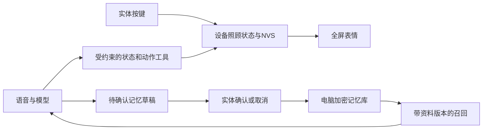

# AI实体伙伴：不用硬件先看证据

一台ESP32-S3小设备：全屏眼睛、三键照顾，以及需要明确确认才能留下的个人记忆。

项目在本地开发中。这里提供真实模型的虚构资料记录、实际设备数值证据和可运行的记忆衰减回放，不需要填写API Key。实机GIF和完整视听视频尚未拍摄，本文不能替代实物演示。

## 先看三个结果

| 体验 | 已有结果 | 证据范围 |
|---|---|---|
| 记住你，也允许改口 | 小林/天文确认后跨进程召回；改为小禾后只用新称呼；全部删除后不再知道 | 真实DeepSeek模型、虚构资料、程序确认；非声学语音测试 |
| 照顾确实改变设备 | 未校时抚摸心情81→89；喂食饱食83→98；无时钟重启后饱食仍为98 | 实际USB事件分发与NVS；不证明按键触点或可见动画 |
| 经历变淡，称呼保留 | 模拟0/7/30天权重1/0.5/0.0513；明确重提后恢复为1 | 真实SQLite、注入时间；非人类遗忘验证 |

## 模型实际说了什么

以下原话摘自已保存的[虚构记忆闭环记录](../evaluation/live-memory-result.json)。写入前由程序完成确认，进程退出后另起进程验证；不是当前实体麦克风录音转写。

**新进程、新会话召回**

> 你是小林，喜欢天文。

**称呼更正并确认后**

> 小禾。

**全部删除并确认后**

> 不确定呢，我的资料里没有你的名字，也没记下你喜欢什么。

## 按键、AI和记忆怎样连在一起

设备状态由本地规则决定，模型不能靠一句“喂好了”改数值。个人资料由电脑记忆库管理，未确认草稿不进入长期记忆。称呼和偏好不因关系变淡自动消失；经历按独立规则降权。电脑离线时保留本地养成，增强语音和个人记忆依赖电脑在线。

## 这份项目主要改了什么

复用小智的同板型驱动和语音基础、RoboEyes眼睛动画，以及MemoryConstellations的部分存储/证据/检索管线。新增全屏适配、三键状态与持久化、关系频率规则、受控记忆确认/更正/删除、动作工具与语音桥接、中文服务控制及异常验证。[来源和许可](../THIRD_PARTY_NOTICES.md)。没有声称自行训练模型、研发整套语音引擎或实现完整记忆星图。

## 自己查看或复现

- [记忆衰减回放与命令](记忆衰减回放.md)：不调用模型，使用独立虚构数据库。
- [离线结算实测记录](../docs/离线结算实现.md)：延迟校时、重启恢复和明确边界，镜像版本见原始记录。
- [无线断开回归](../docs/无线断开实机回归.md)：实际发现RSSI读取导致重启，修复后20秒无线暂停期间可照顾并恢复连接。
- [36条功能验收证据索引](../docs/功能验收证据索引.md)：区分当前/旧固件及未验证项。
- [30条固定AI用例](../evaluation/ai-cases.json)与[执行索引](../evaluation/ai-execution-index.json)：7条记忆API、5条语音模型工具选择有记录，整机验收仍未完成，不是30条通过。
- [运行入口](../README.md)和[中文服务控制](../docs/服务监控使用说明.md)。

校时记录镜像：`27a4f7280af2d016a862530ca50aa494d37bd74b36ef541d95d410b1348fee7d`；当前构建镜像：`cb5efaa25c52fb18c0d8827c05862d59a8820c4466afb18a32d5536f890f7d15`。两者相同时才属于当前镜像的校时证明。

旧版27a4f728镜像已完成2小时只读运行观察。当前镜像2小时观察尚未获得完成证据。 仍缺自然AP故障等网络恢复场景、最终物理按键/视觉/听感验收、20轮语音与动画性能对照及实机视频。旧固件的通过记录不会自动变成当前固件通过；未经验证不写产品成功率、用户留存或量产经验。
