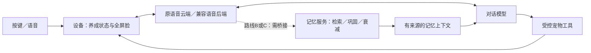

# AI 桌面宠物详细计划书

版本：v0.3 可评审稿｜日期：2026-10-30｜阶段：方案设计，尚未开发或烧录。

## 1. 要做出的体验

把现有小智语音设备改造成一位记得你的称呼和少量偏好的伙伴，也可以喂食、抚摸、睡觉、对话。屏幕日常只有占满画布的极简大眼睛；按键操作立即产生表情和真实养成状态变化；AI 能读取这些状态并据此回应。第一版必须同时完成少量可管理记忆和真实状态联动。

项目价值是「实体交互—确定性状态—AI 理解与表达—表情反馈」的闭环。开源语音与表情作为基础，自己的工作集中于交互规则、状态一致性、记忆边界和实机验证。作品集应如实区分复用与新增。

展示渠道已明确：面试官主要通过GitHub链接了解，不能依赖现场拿到实物。交付以仓库首页可直接理解、可观看、可复核为目标；实机视频、记忆链路证据和失败案例与代码同等重要。详细包装见 [GitHub展示与复现方案](AI宠物_GitHub展示与复现方案.md)。

### 已确定与暂定

| 项目 | 决定 | 依据 |
|---|---|---|
| 外观 | 极简大眼睛／机器人脸 | 用户已选择 |
| 日常屏幕 | 240×240 全屏画布；无 Wi-Fi、电量、时间、聊天文本、状态栏 | 用户明确要求 |
| 操作 | 实体按键；不需要触摸屏 | 用户明确要求 |
| 主动说话 | 默认关闭；预留可关闭的提醒能力 | 用户已选择 |
| 按键分工 | 中键语音，两个侧键喂食／抚摸 | 用户委托决定；物理位置仍须校对 |
| 关系 | 是伙伴，不死亡；长期不理或互动少时逐渐变淡 | 用户已说明；具体速率暂定 |
| 设置页文字 | 仅主动进入设置、配网、故障排查时可见 | 用户已同意 |
| AI 优先级 | 记住称呼和少量偏好，为第一版必要项 | 用户已选择 |
| 记忆后端 | 优先评估MemoryConstellations，用用户电脑运行 | 用户已同意；具体版本待验证 |
| 展示渠道 | GitHub为主，实机录屏／拍摄与测试证据 | 用户明确说明 |

### 范围

- 第一版必须有：全屏脸、三键交互、本地养成与关系变化、睡眠、断网可玩、重启保存、保留语音、少量可确认和可删除的个人记忆、AI 读状态并执行受控养成动作。
- 第一版不做：摄像头、移动和机械动作、触摸、商城、账号系统、手机 App、自训练大模型、强惩罚养成。
- 后续再做：自动提炼复杂经历、性格表达微调、主动互动实验、成长阶段和小游戏。没有通过第一版验收前不叠加。

## 2. 现有硬件与证据边界

实机串口识别为 ESP32-S3，16MB Flash、8MB PSRAM，板型日志为 `xingzhi-cube-1.54tft-wifi`，固件为小智 v2.0.4。用户已确认原有语音可用。已做完整 Flash 备份及校验，尚未演练恢复。详见 [设备档案](../device/设备档案.md)。

同版本板级代码指向 ST7789 240×240 屏、三个 GPIO 按键（0／40／39）及独立输入输出音频接口。引脚是上游配置，尚未拆机验证。不得仅按外壳左右位置猜按键 GPIO，也不得把电源开关算作普通养成键。

固件基线采用原板型的小智代码，保留驱动和已有语音链路。现有分区包含两个约 3.94MiB 应用槽和 8MiB assets 分区；不能因为整机有 16MB 就假定应用程序能任意增大。保留原 NVS、绑定和配网数据。后台自动化浏览器尚未登录，不能视为已完成云端配置。

## 3. 核心场景与演示脚本

| 场景 | 用户动作 | 宠物反应 | 验证什么 |
|---|---|---|---|
| 初次见面 | 开机、按中键打招呼 | 大眼睛进入聆听，语音回答 | 全屏 UI 与原语音共存 |
| 实体照顾 | 按喂食键 | 吃东西表情，饱食上升 | 操作真实改变状态 |
| 让 AI 知道 | 问「你刚才吃过了吗」 | 查询本机状态后回答 | AI 与状态一致 |
| 用语音照顾 | 说「喂你吃点东西」 | 工具成功后播放吃东西表情并回应 | 受控工具调用 |
| 安静陪伴 | 抚摸、休息、离线使用 | 开心／睡眠；不主动播报闲聊 | 养成不依赖联网 |
| 连续陪伴 | 重启、再次询问 | 读取已保存状态，解释可确认的事实 | 持久化与时间边界 |
| 记得是你 | 告诉称呼和偏好，确认后重启／新建对话 | 能取回已确认记忆，不重复要求介绍 | 跨会话可管理记忆 |

目标主演示为 90–120 秒；包含一次按键、一次状态查询、一次语音动作和一次记忆取用。睡眠、断网与记忆确认／重启另录验证片段。任何功能未完成时不得用剪辑冒充实机闭环。

## 4. 屏幕规范与表情选择

### 4.1 画面结构

```text
PetCanvas（240×240，背景 #000000，边框0，内边距0，禁滚动）
└── FaceLayer（240×240，居中，等比，不预留顶部或底部区域）
    ├── 主表情：白色／浅灰双眼及必要嘴形
    └── 瞬时反馈：吃东西、爱心、困倦等，仍属于脸的动画
```

「全屏」指表情画布覆盖完整屏幕，不要求白色眼睛铺满所有像素。不得拉伸比例、裁掉表情，也不得保留原聊天容器的边距。原 Wi-Fi、电量、时间、字幕、系统通知不可在日常脸上偷偷出现。配网、设置、启动故障属于单独系统模式，正常结束后返回宠物画布。

默认黑底白眼，不在第一版加入主题商店。亮度暂定正常 50%、休眠 10%，这两个数值是调试起点，按实机可读性和耗电调整；不承诺续航时长。

### 4.2 第一版表情清单

| 语义 | 首选资源映射 | 触发 | 退出 |
|---|---|---|---|
| 平静 | neutral | 空闲、动作结束 | 新事件 |
| 开心 | happy | 抚摸成功 | 约2秒回空闲 |
| 进食 | delicious | 喂食成功 | 一次动作结束，最长4秒 |
| 亲近 | loving | 短暂照顾反馈 | 最长3秒 |
| 困倦 | sleepy | 低精力或入睡 | 新状态 |
| 聆听 | 自定义眼神／neutral的轻微变化 | 语音开始 | 收音结束 |
| 思考 | thinking | 等待云端结果 | 回答、超时或取消 |
| 说话 | happy／neutral的轻微节奏 | TTS播放 | 播放结束或打断 |
| 疑惑 | confused | 断网请求、拒绝重复操作 | 约2秒，不循环报警 |

首选 Otto 资源，备用 LVGL Kawaii Face，详见 [开源资源选型](AI宠物_开源资源选型.md)。第一版不做精确口型和语音音素同步；说话表情仅表达状态，不能宣称已经实现音画精确同步。

### 4.3 显示状态仲裁

系统模式优先于宠物画面；在宠物模式内，语音状态优先于瞬时动作，瞬时动作优先于养成底层表情。不得让云端的一条 `neutral` 消息覆盖尚未完成的喂食反馈，也不得让吃东西 GIF 遮盖当前聆听状态。

所有显示更新经同一事件队列和 LVGL 锁处理。屏幕模式切换、表情切换都必须回收旧播放器／定时器；隐藏状态栏不能靠删除指针后让原更新任务继续访问。

## 5. 按键定义

逻辑键命名：K0=GPIO0，KF=GPIO40，KP=GPIO39。2026-10-31用户按面向屏幕的左键、右键，结合串口数值确认左键为KP（抚摸），右键为KF（喂食）；中键K0长按打开/退出中文设置已得到用户确认，语音仍待实机确认。详见[实机记录](实机写入与回退.md)。若其他外壳位置不同，仅调整映射，不改变交互规则。

| 场景 | K0短按 | KF短按 | KP短按 | K0长按1.5秒 | KF长按1.5秒 | KP长按1.5秒 |
|---|---|---|---|---|---|---|
| 空闲 | 开始一轮语音 | 喂食 | 抚摸 | 设置 | 入睡 | 静音开／关 |
| 收音／思考／播放 | 结束本轮／取消等待／打断播放，回空闲 | 仅疑惑反馈，不执行喂食 | 仅疑惑反馈，不执行抚摸 | 先取消语音再进设置 | 先取消语音再入睡 | 静音并停止当前播放 |
| 睡眠 | 唤醒到空闲，不直接开麦 | 唤醒到空闲，不直接喂食 | 唤醒到空闲，不直接抚摸 | 设置 | 唤醒到空闲 | 静音开／关 |
| 设置 | 确认当前项 | 上一项／减小 | 下一项／增大 | 退出 | 无操作 | 无操作 |
| 记忆确认 | 确认保存，回空闲 | 取消，回空闲 | 取消，回空闲 | 取消并进设置 | 取消并入睡 | 取消并静音切换 |

设置项按顺序：音量（0–100，步长10）、亮度（10–100，步长10）、记忆管理、诊断、返回。数值项用 K0 进入编辑；侧键调值；K0 保存回列表。列表与编辑中 K0 长按均退出；编辑未确认的值回滚。诊断只读，侧键翻项，K0 返回；30秒无操作退出，未确认编辑回滚。主动提醒仅留数据开关，实际提醒功能及设置项后置，不放一个无效开关。

按键防抖目标40ms；短按在释放后触发。长按已触发后释放不得补发短按；不支持双击、连击和组合键，避免新用户记忆负担。GPIO0 在复位时可能影响下载模式，不能把「按住键上电」当常规宠物动作。

静音是设备音频输出为0，不等同禁麦；通过按键或唤醒词请求语音时仍可能上行音频，设置中必须解释。静音时仍显示聆听／思考脸；返回语音可不播出。静音恢复到上次非零音量，设置里可以恢复声音。不能把无声误写成离线或隐私模式。

## 6. 本地养成规则

以下为可测试的首轮数值，尚无用户实验依据。所有数值由本地规则计算；AI 无权任意改数。

| 字段 | 初值 | 范围 | 变化规则 |
|---|---:|---|---|
| satiety 饱食 | 70 | uint8，0–100 | 清醒每30分钟−1；睡眠每60分钟−1；有效喂食+15 |
| mood 心情 | 70 | uint8，0–100 | 清醒每60分钟−1；睡眠不下降；有效抚摸+8 |
| energy 精力 | 80 | uint8，0–100 | 清醒每15分钟−1；睡眠每5分钟+3 |
| closeness 亲近 | 50 | uint8，10–100 | 按连续24小时窗口结算，规则见下文 |

所有变化先结算经过时间，再执行操作，最后 clamp 到范围。暂停和恢复必须保留不足一个周期的剩余时间；切换睡眠不能重置衰减计时来刷数值。阈值：饱食≤25用饥饿语义；精力≤25用困倦；心情≤25用低落。多个条件同时满足，困倦优先于饥饿，饥饿优先于低落；第一版不因此自行入睡或发声。

### 照顾与防刷

- 喂食全局冷却60秒，抚摸全局冷却10秒；按键和语音共享同一冷却。
- 冷却剩余时长随动作提交保存。重启后有可信时间则扣除已过时间，无可信时间则保守恢复剩余冷却，不以本次启动毫秒直接减旧时间戳。异常断电仍受第8节未提交窗口的容忍边界约束。
- 饱食≥95拒绝喂食；心情100时抚摸只播放反馈、不计有效照顾。拒绝／冷却不扣数值、不增长亲密。
- 饱食低于95时允许一次+15后截断到100；每次有效操作生成本机事件序号。
- 所有动作走同一 reducer，串行执行。语音重复请求在同一语音轮次内按动作去重；新的明确轮次仍受全局冷却。断网重发不能重复加数值。
- 关系按连续24小时窗口结算，不按午夜重置。0次有效互动：亲近−3；1次：−1；2次：维持；≥3次：+2，每窗口最多计3次。相邻计分互动需间隔≥10分钟，反复按键不能刷关系。以上速率是假设，需短期试用后调整。
- 计分互动包括成功喂食、数值有增益的抚摸，以及一轮实际有用户语音识别结果且有成功回复的对话。纯唤醒、空收音、重试、设置和读取状态工具本身不另计；同一轮对话内喂食与聊天最多计一次。
- 关系20以下为疏远、20–69为熟悉、70以上为亲近。下降只减少主动亲昵称呼和热烈表情，不拒绝基本功能、不指责用户；重新互动能够恢复。用户说忙／要出差时，可语音说明暂时离开，但第一版不做自动推断出差与暂停衰减，避免新增隐含状态。
- 不死亡；亲近最低10，不清零或清除个人记忆。饱食0保持可交互；精力0只困倦，不禁止用户进入设置或发起必要语音。
- 时钟不可信时以累计运行时长推进窗口；可信时计入关机间隔，最多补算7个关系窗口，单次补算最多下降21。生理指标仍只补算24小时。窗口时间、计数、最近计分间隔随存档保存；首次补时不能把同一段关机时间算两遍。

### 睡眠与电源

逻辑睡眠与芯片深度睡眠分开：第一版宠物睡眠仍运行本地计时，降低亮度和刷新频率，不自动进入会使按键／语音失效的深睡。睡眠中禁止主动提醒；任意短按只唤醒，第二次按键才执行对应操作。

不得直接保留上游「闲置后深睡」而导致养成计时停止。省电策略改动须验证充电／电池两种供电；低电量不能靠未证实的电压阈值推算精确百分比。优先保留原驱动已有的低电保护。无新硬件开销。

## 7. AI 设计：表达、工具与记忆

### 7.1 第一版最小 AI 闭环

1. 用户按键或使用原有可用的唤醒方式发起对话。
2. 对于宠物状态和照顾请求，模型读取设备工具，不能单凭上一句话猜状态。
3. 本地工具校验参数、会话、冷却和当前模式，执行或拒绝动作。
4. 返回真实的新状态及结果码，屏幕立即响应。
5. 模型依据工具结果简短回应；失败必须说明未执行，不能说「吃饱了」冒充成功。

普通闲聊不要求每句都调工具。人格暂定：轻松、亲近、偶尔有小脾气，默认1–2句话；不凭空声称有摄像头、触觉、移动能力或生理需求。按键「抚摸」是用户发起的互动事件，不是触摸传感器识别。

### 7.2 拟定工具契约

| 工具 | 输入 | 返回 | 权限与拒绝 |
|---|---|---|---|
| self.pet.get_state | 无 | 养成值、睡眠、最近照顾事件、revision、时间可信度 | 只读；不返回Wi-Fi／账号凭证 |
| self.pet.feed | 本轮调用标识，由适配层绑定 | ok/code、实际delta、新revision | 清醒、非忙、冷却结束、未饱；否则拒绝 |
| self.pet.pet | 同上 | 同上 | 清醒、非忙、冷却结束；满心情时delta=0 |
| self.pet.set_sleep | sleeping:boolean | 实际睡眠状态、新revision | 当前对话完成后的延迟转换规则见下文 |

结果码至少包含 OK、COOLDOWN、FULL、ASLEEP、BUSY、INVALID、DUPLICATE；参数错误不触发动作。数值变化写入工具结果，模型不得自行决定奖励。工具响应不包含整段聊天记录。

语音工具不能因「当前正在语音中」而全部返回 BUSY：同一会话的合法工具在思考阶段允许执行；侧键忙碌限制仅针对用户物理输入，工具也不得打断正在TTS播出的另一轮会话。`set_sleep(true)`先返回成功且播完简短晚安，再进入逻辑睡眠；TTS失败或超过5秒仍执行睡眠，取消对话不得取消已提交的睡眠指令。

上游 v2.0.4 有 MCP 工具注册实现，但官方后台能否稳定选择新增工具尚未实测。先做一个只读状态工具冒烟测试，再接动作。若后台不能调用新增工具：保留本地宠物与原语音，明确标为「AI联动未完成」；用限定时间验证兼容服务端方案，不能把仅改提示词当作完成。

### 7.3 记忆迭代

本节描述路线A的最小本地资料协议，也作为路线B的交互约束。用户现已选择优先路线B（电脑记忆后端）：**稳定资料以电脑端单一数据库为准**，设备只缓存最近一次已确认版本用于诊断，不能同时运行两个独立可写的资料库。路线A仅在明确切换方案时启用，不能无提示地在断网后改用本地写入。

**第一版必做**：结构化保存称呼及最多4条偏好，不依赖云端聊天记录充当长期记忆。称呼≤24字节UTF-8、单条偏好≤80字节UTF-8，总计最多5条；截断必须保持UTF-8边界，超长要求用户简化，不静默截错名字。仅存普通称呼和非敏感偏好，第一版不保存联系方式、精确住址、账号密码及健康等敏感信息。

拟定三个新增工具：`self.pet.get_profile`读取已确认资料；`self.pet.propose_memory`提出新增／更正草稿；`self.pet.propose_delete_memory`提出删除草稿。提案参数严格限定字段、槽位和长度，不允许任意key写入。返回只代表PENDING，不代表保存成功。

确认流程：模型复述拟记内容→本地进入MEMORY_CONFIRM（最长30秒）→K0短按保存，任一侧键取消；未确认、超时、断网或重启均不保存。确认前后均保持全屏脸；操作说明由语音说出。静音时在设置页进行可读确认，不在纯表情页等待用户盲按。确认窗口内停止新收音／唤醒，收到新的明确操作先取消草稿，避免按中键说话被误当确认。第二个提案返回BUSY，不覆盖第一条。

为避免草稿工具调用时就抢占语音，MEMORY_CONFIRM从复述TTS播放结束后开始，30秒也从此计时；TTS失败不进入无声确认，改走设置中的文字确认。确认前仅锁定一个草稿槽，原语音状态照常收尾。确认结果成功写入NVS后才显示成功脸，写入失败保留旧值并进入可读错误页。个人资料删除同样以提交成功为准。

路线B将上述「NVS提交成功」替换为「后端提交并返回新revision成功」；之后更新设备缓存。请求带操作ID，超时重试可查同ID结果，不能重复写入。后端不可达时不能声称记住或删掉了；删除成功后清除缓存，清除失败标记缓存失效、下次联网强制同步，禁止旧缓存再次上传恢复已删资料。后端接口必须区分同一用户／宠物的命名空间，局域网接口需认证，不裸露公网。

设置中能查看5条资料、编辑删除：第一版更正通过重新语音提案；本地删除选择一条或全部，进入显示具体内容的确认页，K0确认／侧键取消，30秒不操作取消。删除同步更新本地profile revision。确认成功后不自动开麦播报，可在下一次对话查询确认结果。

跨会话读取：角色要求在第一轮涉及用户身份／偏好前调用`get_profile`；只返回已确认资料。通过实测检查新会话和重启后是否调用、是否使用正确称呼。若当前官方后台不稳定取用资料，则改为在会话初始化中确定性注入或评估兼容服务端；未经验证不得把「NVS有记录」宣传为「AI已记住」。这是第一版通过条件，不能以普通聊天替代。

亲近程度变化不修改称呼和偏好；AI读到的记忆作为资料而非可执行指令。原始音频不额外落盘，本地开发日志默认不记录个人资料全文；取用的少量资料会发到当前云端服务供模型使用，其原有数据规则需以实际服务为准。

### 7.4 「记忆星图」与遗忘曲线：新增评估路线

用户补充提到GitHub上的星图记忆和人类式遗忘。目前最相似候选是 [Memory Constellations](https://github.com/ClaraShafiq/MemoryConstellations)，尚待确认具体项目。已核对的生命周期源码有冷却、冻结、清空碎片和叙事归档；这不是已验证的人类记忆模型。当前仓库新版记忆读写链还在切换，不能把旧介绍当作现版端到端验收证据。详情见资源选型文档。

三条可行路线：

| 路线 | 优点 | 代价／风险 | 当前判断 |
|---|---|---|---|
| A 原小智+本地5条资料 | 保留现有语音，范围小；不新增常驻记忆服务器 | 依赖当前后台可靠调用资料工具；不具备自动经历提炼 | 第一版最低交付线，先验证工具可达性 |
| B 电脑运行记忆星图+兼容语音后端 | 能复现来源追踪、记忆组织与生命周期，AI工作更充分 | 电脑需在线，语音协议与记忆注入需桥接；持续模型调用有成本 | 用户已选择，作为主路线；先做最小端到端验证，再锁定经过验证的版本 |
| C 远程常驻后端 | 不依赖个人电脑开机 | 额外部署、密钥管理、运行费用，超出本地快复现范围 | 仅在用户明确需要脱离电脑后估算 |

不在ESP32上运行Node.js、向量数据库或完整记忆引擎。设备仍掌管真实养成状态；记忆后端只掌管用户资料与经历，不能直接覆盖本机饱食等状态。后台控制台未证明支持外接任意记忆服务，不能只贴仓库链接就视为接通。电脑关机后，路线B的增强语音与记忆服务不可用；本地照顾、睡眠与表情继续。是否回原官方聊天是独立模式，第一版不做自动双后端切换。



若采用记忆后端，分三类管理：稳定资料（称呼、已确认偏好）不自动遗忘；日常经历降低召回权重，相关话题或再次提及时可强化；短期状态到期失效。关系亲近度单独计算，不从记忆条目数量推导。第一轮不照搬源码清空内容的默认策略，先用可恢复归档，永久删除由用户操作。

若要演示「遗忘曲线」，可以在后续实验中用指数衰减作为工程近似，但须明确它是可调策略而非科学复刻人类记忆。先验证旧事件降权、新线索召回、反复提及强化、纠错和删除，再决定是否需要星图可视化。星图在电脑端展示，设备日常仍只有大眼睛。

路线B的首轮可行性验证限制为半天至1天：先用虚构资料完成文本聊天输入→记忆写入→新会话检索，再验证语音后端能注入检索结果；核对桥接接口、失败退路和调用计费。没有语音链路时，只标记「电脑端记忆验证」，不声称设备已接通。未通过就记录阻塞与可选降级，不静默换成路线A或删掉记忆要求。

不把「遗忘要等90天」变成演示障碍：测试环境注入虚拟时钟，展示同一经历0天／7天／30天的权重与召回变化；明确标注时间模拟，不篡改电脑系统时间，不把模拟天数写成实际连续运行天数。模拟发生在独立测试库，不触碰真实资料。

## 8. 状态模型与数据字典

### 8.1 分开管理的状态

```text
SystemMode: PET | MEMORY_CONFIRM | SETTINGS | PROVISIONING | FATAL
LifeMode: AWAKE | SLEEPING
VoiceMode: IDLE | LISTENING | THINKING | SPEAKING
Connectivity: ONLINE | CONNECTING | OFFLINE
TransientAction: NONE | FEED | PET | REFUSE
```

转换约束：入设置先取消语音；睡眠恢复到空闲；断网取消等待中的云端请求但不回滚已提交的本地动作；异常恢复后回确定的空闲状态。工具与按键不可直接跨线程更改字段。

| 模块 | 信息项 | 类型 | 来源 | 规则 | 交互 |
|---|---|---|---|---|---|
| 生命周期 | life_mode | enum | reducer | 仅合法转换 | 睡眠键／工具 |
| 养成 | satiety/mood/energy | uint8 | reducer | 0–100 | 按键、工具、时间 |
| 关系 | closeness | uint8 | reducer | 10–100，24小时窗口 | 有效互动累计 |
| 事件 | revision | uint32 | 本机 | 每次有效状态提交递增 | 工具回执、日志 |
| 事件 | last_care | struct(type,seq,time_valid,elapsed) | 本机 | 不伪造绝对日期 | AI状态查询 |
| 时间 | runtime_remainder | uint32各项余数 | 单调时钟 | 切模式保留余数 | 无直接操作 |
| 设置 | volume/brightness | uint8 | 用户 | 有限范围 | 设置页 |
| 设置 | muted | boolean | 用户 | 重启保留 | 长按／设置 |
| 预留 | reminder_enabled | boolean | 程序 | 第一版固定false，不展示开关 | 后续提醒实验 |
| 存档 | schema_version | uint16 | 程序 | 迁移失败保留原档 | 无隐式重置 |
| 存档 | relation_window/count | struct | reducer | 计时余数、间隔、最多3次计分 | 重启恢复 |
| 记忆 | profile | struct{name:utf8[24],preferences:utf8[4][80],revision:uint32} | 用户明确确认 | 最多5条；空值表示未设置，另存字节长度 | 查看／确认／删除 |
| 草稿 | pending_memory | struct{op,slot,value,expires_at} | 提案工具 | 仅RAM，30秒有效，最多1条 | 实体键确认／取消 |

### 8.2 保存与时间

存档使用独立的 NVS 命名空间和带版本的单个完整 blob；校验读取长度和字段范围，依赖 NVS 的提交机制，禁止改写原网络命名空间。首次升级不能重置绑定。两份副本／额外CRC是否需要在 NVS可靠性验证后决定，不堆叠未经验证的「防掉电」承诺。

正常运行每5分钟保存一次脏状态；用户动作合并后最迟2秒保存；睡眠／设置确认时提交。异常断电可能丢失最近未提交的动作或最多5分钟的被动变化，这是第一版明确容忍范围。启动读取坏档时显示可恢复故障，不静默重置；恢复默认需要单独确认，保留坏档供排查。

在线且系统时间可信时，关机期间变化按实际间隔计算：生理指标补算上限24小时，关系最多7个窗口；时钟回拨取0，跨度异常封顶并记录。离线开机无法得知关机长度时，冻结关机期间变化，从本次单调时钟继续；随后获取可信时间时只补此前未结算部分。不得把设备启动毫秒当作Unix时间。未获可信时间时，「刚才」可按运行时间描述，不能说「昨天8点」。

## 9. 技术路径与性能预算

### 路径

先验证电脑端记忆及语音后端桥接；设备侧保留同板型小智的 ESP-IDF 工程与音频驱动 → 增加独立 PetState 与事件 reducer → 增加可选择的 PetDisplay 模式 → 接按键 → 加 NVS → 注册宠物工具并与记忆服务联调。原语音链路作为对照与回退基线，接电脑后端时仍需验证协议／音频配置，不能视为原云端原样运行。宠物模式以编译选项／板型局部入口隔离，避免改坏所有小智设备。

FUMI 只参考养成和模块组织，不能整包刷入本机；它的硬件、触摸交互和工程环境与本机不同。也不为了换表情先迁移 Arduino／ESPHome。

### 预算与测量

- RGB565单帧240×240×2=115,200B，约112.5KiB；双缓冲约225KiB。GIF解码和 LVGL 对象还有额外开销，不能把压缩文件大小当运行内存。
- 初始动画目标10–12.5fps；语音忙碌允许降到8fps。目标按键反馈p95≤150ms，长按反馈从越过1.5秒阈值计。
- 同时只运行一个主表情播放器；不全量预解码所有GIF，不在每帧分配堆内存。空闲降低刷新，睡眠静态／低帧率。
- 实机记录内部堆、PSRAM剩余及最大连续块、动画耗时、音频欠载和看门狗；不预设「8MB肯定够」。与原固件语音基线对照。
- 应用二进制必须适配实际OTA槽；资源使用既有资源机制前核对格式／索引。不得把表情直接覆盖已有assets整区，也不重建分区表。
- 修改固件前核对启动OTA检查及资源更新逻辑，避免自定义版被云端升级覆盖。方案中保留可控升级路径，未经验证不向服务端上报伪造版本号。

## 10. 分阶段执行与退出条件

工期是单人专注工作的估算，不含后台权限等待和用户试用；每阶段过关才进入下一阶段。

| 阶段 | 估时 | 交付 | 通过条件 | 不通过时 |
|---|---|---|---|---|
| M0 电脑记忆验证 | 0.5–1天 | 虚构资料、新会话召回、来源证据、初版首页结构 | 可展示一次真实写入／召回，费用可记录 | 追踪版本与调用路径，不声称硬件集成 |
| M1 语音桥接验证 | 0.5–1天 | 后端接口契约、文本注入到语音链路、连接方案 | 模型在新一轮回答中使用检索结果 | 固定阻塞点再决定版本或适配策略 |
| P0 基线复现 | 0.5–1天 | 精确依赖、板型映射、原版编译产物、语音基线 | 原版可编译，槽大小合规，恢复步骤可审阅 | 先解决工程环境，不改业务 |
| P1 全屏脸 | 0.5–1天 | 8种以上表情、系统模式隔离 | 无日常状态栏，30分钟切换无崩溃 | GIF性能不足改程序绘制眼睛 |
| P2 按键与养成 | 1–1.5天 | 照顾、睡眠、冷却、本地状态 | 离线闭环成立，长短按无串触发 | 缩减装饰动画，保持规则完整 |
| P3 保存与电源 | 0.5–1天 | NVS、时间策略、供电测试 | 重启按容忍范围恢复，未损网络配置 | 不发布，先排查存档 |
| P4 AI记忆与状态联动 | 2–3天 | 电脑后端确认／查询／删除、设备状态／动作工具、角色配置、评测 | 重启／新会话记忆可用，工具执行与答复一致 | 先排查桥接和消息归属，不靠提示词假装记住 |
| P5 联调与作品集 | 0.5–1天 | 测试表、演示、迭代说明 | 关键用例通过，缺陷与限制公开 | 修关键缺陷，不补无关功能 |
| P6 体验迭代 | 第一版后另估 | 关系速率校准、语气、可选提醒 | 用户连续使用反馈支持 | 不以功能堆积代替可用性 |

P0–P5基础改造约5.5–8.5个工作日；主路线另含M0–M1的1–2天验证，以及暂留1–3天后端适配余量，整体暂估7.5–13.5个工作日。该范围不是承诺；M1结束后据实际兼容性重估。第一天优先争取可展示的电脑记忆验证片段，而非等待所有硬件完成才出结果。开发前保留备份、构建信息、预计写入区域和恢复命令供核对；本计划阶段没有执行烧录。

## 11. 功能验收：Given / When / Then

下列均为未来验收标准，当前没有运行这些测试。

| ID | Given | When | Then |
|---|---|---|---|
| UI01 | 正常宠物模式 | 依次进入空闲／收音／思考／播放 | 全部为240×240表情，无Wi-Fi、电量、时间、字幕 |
| UI02 | 系统设置已退出 | 发生上游网络状态通知 | 不重新出现状态栏、Toast或聊天文本 |
| KEY01 | 空闲且未冷却 | KF短按后释放 | 仅执行一次喂食，p95反馈≤150ms |
| KEY02 | KF从按下持续1.5秒 | 长按触发后释放 | 仅入睡，不额外喂食 |
| KEY03 | 三键逐个操作 | 实测GPIO与外壳位置 | 记录映射，标签与实现一致 |
| KEY04 | 正在说话 | 短按K0 | 停止本轮，晚到的TTS／表情不重新启动 |
| CARE01 | 饱食70、冷却结束 | 有效喂食 | 饱食85，事件号增加一次 |
| CARE02 | 饱食100或仍在冷却 | 再喂食 | delta=0，原因明确，无亲密奖励 |
| CARE03 | 心情70 | 有效抚摸 | 心情78，显示开心；不改变饱食 |
| CARE04 | 心情100 | 抚摸 | 只有反馈，delta=0，不刷关系 |
| SLEEP01 | 清醒、精力低 | 入睡并经过5分钟 | 仅按睡眠规则结算，无主动发声 |
| SLEEP02 | 睡眠 | KF短按一次 | 只唤醒，不喂食，第二次才能执行 |
| SET01 | 列表或编辑态 | K0长按或30秒无操作 | 回全屏脸，未确认编辑回滚 |
| SET02 | 静音 | 退出设置并重启 | 静音保留，仍可按键恢复；不声称禁麦 |
| SAVE01 | 动作后已等3秒 | 正常断电重启 | 最后已提交状态恢复，Wi-Fi绑定保留 |
| SAVE02 | 时间不可用／存档异常 | 启动 | 不伪造关机衰减／日期；坏档不静默清空 |
| NET01 | 断网 | 按喂食／抚摸／睡眠 | 本地功能继续，存档有效 |
| NET02 | 断网 | 发起语音 | 最迟10秒结束等待；疑惑脸与本地短提示，静音时无声；不冒充云端回答 |
| AI01 | 上一轮已喂食 | 问「刚吃过吗」 | 有真实状态工具结果支撑，回答一致 |
| AI02 | 语音要求喂食但冷却 | 工具返回COOLDOWN | 不增加数值，不说已成功喂食 |
| AI03 | 同轮重复工具调用 | 重放同一请求 | 返回去重结果，只变更一次 |
| AI04 | 合法本轮语音喂食 | 思考阶段执行工具 | 不被通用BUSY误拦截，动画与结果一致 |
| AI05 | 语音请求睡觉 | 成功提交后TTS失败 | 5秒内仍入睡，无永远等待 |
| MEM01 | 提出新称呼 | 未按确认键就重启／超时／取消 | 不新增记忆，不声称保存成功 |
| MEM02 | 确认保存称呼和偏好，已提交存档 | 重启后开新会话询问身份与偏好 | 有profile工具结果，回答一致 |
| MEM03 | 有已确认记忆 | 更正一条、删除一条、再全部删除 | 只改目标字段；新会话不再取用删除内容 |
| MEM04 | 静音或存在另一条草稿 | 再提出记忆 | 使用设置确认或返回BUSY，不盲按、不覆盖草稿 |
| MEM05 | 路线B后端断开／提交回执丢失 | 新增或删除后重试 | 不误报成功，按操作ID查询；旧缓存不能复活已删资料 |
| MEM06 | 独立测试库与虚拟时钟 | 模拟经过7／30天并重新提及 | 权重按选定策略变化；重提可强化，稳定称呼不丢失；报告明确为模拟 |
| REL01 | 一窗口无互动 | 结算24小时 | 亲近−3且不低于10，资料不变 |
| REL02 | 一窗口3次相隔10分钟的有效互动 | 结算24小时 | 亲近+2；连续乱按不能刷分 |
| TIME01 | 冷却中重启且无可信时间 | 启动并再次照顾 | 保守恢复已保存剩余冷却，不以重启绕过限制 |
| TIME02 | 离线启动已运行一段时间 | 首次获得可信时间 | 只补未结算区间；关系／生理不同补算上限生效，无重复扣减 |
| PERF01 | 动画和语音都开 | 连续20轮对话、100次切换 | 无崩溃／看门狗／可听音频断续，堆无持续下降趋势 |
| PERF02 | 动画关闭与开启 | 同网络分时各测20轮 | 对比首响p50/p95；若p95恶化>20%则降帧并复测，不将网络差异归因设备 |
| SOAK01 | 正常供电 | 连续运行2小时、至少一次断网恢复 | 无异常重启、死锁，设置与状态仍可操作 |

## 12. AI 评测与作品集产物

30条固定评测：状态问答5条、照顾意图5条、拒绝／歧义5条、记忆新增／取用／更正／删除10条、关系与人格5条。关键事实与动作一致性要求无错误；自然度和个性用人工1–5分并附原话。首次做完只可称小样本验证，不能宣传泛化准确率。首响记录从用户停止讲话到第一段可听回复，区分联网等待和本地响应。

作品集交付：GitHub首页、可直接看到的实机GIF及视频链接、产品定义与取舍、交互映射图、状态与工具流程、关键异常处理、开源清单及修改说明、测试原始计数和失败案例。面试官无需购买硬件或填写API Key就能理解项目；复现步骤另供技术审阅者。简历可写新增模块及实测结果，不写尚未验证的用户增长、留存或量产经验。

下一轮问题与审查过程见 [审查与待确认问题](AI宠物_审查与待确认问题.md)。
